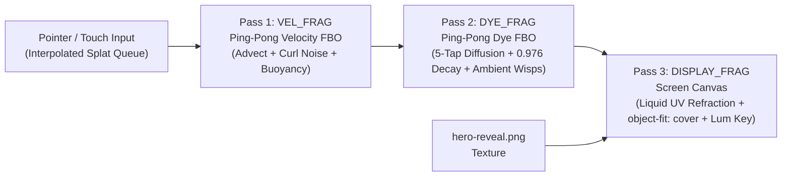

# VELA — Architectural Luxury Product Showcase Build Guide

A complete, reusable engineering playbook for recreating this luxury editorial e-commerce showcase (currently configured as **VELA — DONUT V (I / II / III)** in the **Deep Pine & Warm Alabaster** palette) and adapting it to any future product, brand, or theme.

---

## 1. Architecture & Tech Stack

The site achieves a ~27 KB gzipped production bundle and 60 fps scroll choreography by avoiding heavy runtime frameworks and pairing vanilla ES modules with focused graphics engines:

| Layer | Technology | Role |
| --- | --- | --- |
| Build & Dev Server | **Vite 6** (`es2020`) | Fast HMR, asset serving, single-bundle production output |
| Smooth Scrolling | **Lenis** (`^1.3.1`) | Inertial wheel scrolling (`lerp: 0.1`) with clean modal scroll locking |
| Hero Interactive Reveal | **Raw WebGL1** (`hero-webgl.js`) | 3-pass `256×256` ping-pong velocity + dye fluid simulation revealing a paired foreground plate |
| Brand Mark | **Raw WebGL1 SDF** (`mark-webgl.js`) | 12-dot soft-boolean metaball blooming mark (preloader + footer) + crisp SVG fallback |
| Technical Drafting | **Parametric 3D SVG Engine** (`cad-engine.js`) | Real-time 3D Euler projection into 1 px architectural wireframes and dimension callouts |
| Studio Photography | **Three.js + Headless Playwright** (`studio-renderer.html` + `capture-studio.py`) | Offline deterministic PBR studio renderer generating all 25 pixel-locked product, editorial, and holdout-occluded PNG plates |
| QA & Visual Testing | **Playwright + FFmpeg** (`verify-site.py`) | 13-check desktop (`1440×900`) and mobile (`390×844`) E2E harness + contact-sheet generation |

---

## 2. Project File Structure

```text
vela-atelier/
├── index.html                    # Full SPA markup: Preloader, Header, Hero, 6-Act Story, Collection, Studio, Footer, 6 Overlays
├── package.json                  # Scripts: dev (port 5178), build, preview; deps: lenis; devDeps: three, vite
├── vite.config.js                # Port 5178 strictPort + es2020 target
├── public/
│   ├── favicon.svg               # 12-dot brand mark favicon matching active theme
│   └── img/                      # 25 generated PBR studio PNG plates
├── src/
│   ├── main.js                   # App controller: Lenis, Preloader, 6-act choreography, Interactive Studio, PDP, Cart, Router
│   ├── data/
│   │   └── catalog.js            # Brand strings, 3 edition variants (I/II/III), PDP gallery, Spiral photos, Collection metadata
│   ├── modules/
│   │   ├── hero-webgl.js         # 3-pass WebGL1 ping-pong fluid reveal shader + object-fit: cover UV sync
│   │   ├── mark-webgl.js         # WebGL1 12-dot SDF blooming mark + 2D Canvas fallback + static SVG generator
│   │   └── cad-engine.js         # 3D wireframe projector for Act 2 wipe, Act 3 spin, Act 5 cards, Act 6 table morph, PDP dims
│   └── styles/
│       └── main.css              # 1440px -> --s fluid scale, theme tokens, layout, overlays, mobile <=768px overrides
└── scripts/
    ├── studio-renderer.html      # Three.js WebGL2 PBR studio lighting, procedural textures, 3D geometry, and 25 camera rigs
    ├── capture-studio.py         # Serves studio-renderer.html over localhost and captures all 25 PNGs via Chromium
    └── verify-site.py            # 13-assertion desktop + mobile Playwright E2E and screenshot verification script
```

---

## 3. Step 1: Project Setup

### `package.json`
```json
{
  "name": "vela-objects",
  "private": true,
  "version": "1.0.0",
  "type": "module",
  "scripts": {
    "dev": "vite --port 5178",
    "build": "vite build",
    "preview": "vite preview --port 5178"
  },
  "dependencies": {
    "lenis": "^1.3.1"
  },
  "devDependencies": {
    "three": "^0.187.0",
    "vite": "^6.2.0"
  }
}
```

### `vite.config.js`
```js
import { defineConfig } from 'vite'

export default defineConfig({
  server: { port: 5178, strictPort: true },
  build: { target: 'es2020' },
})
```

### Prerequisites & Install
```powershell
npm install
pip install playwright
playwright install chromium
```

### Typography
Load a sculpted classical display serif in `index.html`:
```html
<link rel="preconnect" href="https://fonts.googleapis.com" />
<link rel="preconnect" href="https://fonts.gstatic.com" crossorigin />
<link href="https://fonts.googleapis.com/css2?family=Gilda+Display&family=Marcellus&display=swap" rel="stylesheet" />
```

---

## 4. Step 2: Artboard-Locked Fluid Design System (`src/styles/main.css`)

### Fluid Proportional Unit (`--s`)
Every spacing, font size, grid column, and SVG wrapper scales proportionally from a `1440px` desktop artboard (and switches to a `390px` mobile artboard at `<= 768px`):

```css
:root {
  --s: calc(var(--vw, 100vw) / 1440);
  --cols: 12;
  --margin: calc(20 * var(--s));
  --gutter: calc(20 * var(--s));
  --font-serif: "Marcellus", "Gilda Display", Georgia, serif;
  --ease: cubic-bezier(.43, .195, .02, 1);
  --ease-in-out: cubic-bezier(.76, 0, .2, 1);
}
```

### Theme Tokens (Deep Pine & Warm Alabaster)
Swap these CSS custom properties to completely re-theme the site without touching layout rules:

| Token | Value | Usage |
| --- | --- | --- |
| `--color-ground` | `#0d1814` | Root background behind hero |
| `--color-obsidian` | `#0f1c17` | Collection, Footer, Drawers, Checkout, About dark surfaces |
| `--color-ink` | `#f3efe6` | Primary text on dark surfaces |
| `--color-paper` | `#f3efe6` | Light editorial story & PDP ground |
| `--color-card` | `#faf7f0` | Elevated card & thumbnail boxes |
| `--color-ink-dark` | `#1a2621` | Primary text on light surfaces |
| `--color-muted` | `#8b968e` | Secondary labels & metadata |
| `--color-line` | `#5c7065` | 1 px architectural CAD stroke color |
| `--color-accent` | `#b8925a` | Burnished brass accent (borders, active states, feedback) |
| `--pdp-rule` | `#cfc8ba` | Subtle hairline dividers on PDP |
| `--bq-top` | `#09130f` | Upper dark band of split-horizon studio |
| `--bq-foot` | `#ddd6c8` | Lower stone band of split-horizon studio |

> **Sync note:** Whenever you change `--color-paper`, `--color-obsidian`, `--color-line`, or `--bq-top`, also sync those exact RGB/hex values in `src/modules/mark-webgl.js` (`PAPER`, `INK`), `src/modules/cad-engine.js` (`stroke="#5c7065"`), `public/favicon.svg`, and `scripts/studio-renderer.html`.

### Type Scale & Micro-Interactions
- **Type utilities:** `.t12` (`12 * --s`, uppercase), `.t12s` (`12 * --s`, sentence prose, `1.2` leading), `.t30` (`30 * --s`), `.t50` (`50 * --s`), `.t120` (`120 * --s`, `-0.02em` tracking).
- **Solid button text-roll (`.roll`):** Wrap button label in `<span class="roll" data-text="LABEL"><span>LABEL</span></span>`. On `:hover`, both the inner `<span>` and `::after` pseudo-element translate `-100%` smoothly along `Y`.
- **Z-index layers:** `--layer-content: 1`, `--layer-header: 10`, `--layer-soon: 11`, `--layer-drawer: 20`, `--layer-preloader: 100`.
- **Sticky safety on mobile:** Use `overflow-x: clip` (never `overflow-x: hidden`) on `html, body, main` inside `@media (max-width: 768px)` so `position: sticky` acts keep working while preventing horizontal scroll.

---

## 5. Step 3: Headless 3D Studio Photography Pipeline

Instead of relying on inconsistent external stock or AI image generators, `scripts/studio-renderer.html` builds the products procedurally in **Three.js** with ACES Filmic tone mapping, soft PCF shadows, and procedural equirectangular studio softbox reflections (`PMREMGenerator`). `scripts/capture-studio.py` spins up a local HTTP server and screenshots each angle via headless Playwright Chromium.

### Complete 25-Plate Asset Manifest (`public/img/`)

| Filename | Resolution | Transparent | Purpose |
| --- | --- | --- | --- |
| `hero-bare.png` | `1600×1200` | No | Hero base layer: 3 products on dark `#08110e` pine pedestals |
| `hero-reveal.png` | `1600×1200` | No | Hero WebGL reveal plate: **exact same** `#08110e` background & product lighting + cascading 3D sprinkles |
| `donut-34.png` | `800×1000` | No | Signature 3/4 studio shot (Act 1 strip, Collection `01`, Store card, Spiral) |
| `donut-front.png` | `800×1000` | No | Eye-level front elevation (Act 1 strip, Spiral) |
| `donut-above.png` | `800×1000` | No | High-angle 3/4 view (PDP gallery, Spiral) |
| `donut-top.png` | `800×1000` | No | Pure `90°` orthographic top-down plan on exact `#f3efe6` paper for Act 2 CAD wipe |
| `donut-ii.png` | `800×1000` | No | Edition (II) hero studio elevation (PDP gallery, Spiral) |
| `donut-i.png` | `800×1000` | No | Edition (I) hero studio elevation (PDP gallery, Spiral) |
| `thumb-i.png` .. `thumb-iii.png` | `400×400` | No | Square `#faf7f0` thumbnails for Cart drawer and Checkout rows |
| `collection-choux.png`, `collection-canele.png` | `800×1000` | No | Coming-soon companion products `02` and `03` |
| `editorial-dining.png`, `editorial-study.png`, `editorial-plinth.png`, `editorial-dark.png`, `editorial-close.png` | `800×1000` | No | 5 architectural interior & macro shots for Act 4 Spiral and PDP gallery |
| `studio-horizon.png` | `1600×900` | No | Split-horizon studio base (`#09130f` top / `#ddd6c8` stone table) with 3 bare products |
| `studio-glaze-1.png` .. `studio-glaze-3.png` | `1600×900` | **Yes** | Holdout-occluded reveal overlays (glaze + toppings only) pixel-locked onto each bare product |
| `studio-bowl-1.png` .. `studio-bowl-3.png` | `1600×900` | **Yes** | Individual clickable foreground accessories (ceramic dipping bowls + contact shadows) |

### Three Key Techniques in `studio-renderer.html`

1. **Zero-Seam Hero Reveal Matching:**
   `hero-bare` and `hero-reveal` MUST share the exact same background hex (`#08110e`), exact same camera, and exact same key/rim lights on the hero products. Add only the reveal elements (e.g. 280 clearcoat 3D capsule jimmies, sugar pearls, and confetti discs with subtle `emissiveIntensity: 0.55`) inside `if (isReveal) { ... }`. This guarantees zero brightness jump when the WebGL fluid sweeps across the product edges.
2. **Depth-Only Holdout Occlusion for Interactive Overlays:**
   When rendering `studio-glaze-1..3` with `omit_background=True`, render the base product using an invisible depth-writing holdout material:
   ```js
   const doughM = holdoutDough
     ? new THREE.MeshBasicMaterial({ colorWrite: false, depthWrite: true })
     : briocheMat()
   ```
   The GPU clips any back-facing glaze drips behind the dough automatically, so the transparent PNG composites onto `studio-horizon.png` with true 3D occlusion.
3. **Exact 3D-to-CSS Hitbox Projection:**
   After setting up the studio camera, project each clickable 3D object center into normalized CSS percentages:
   ```js
   window.__studioBowlBoxes = bowlPositions.map(([x, y, z]) => {
     const v = new THREE.Vector3(x, y + 0.14, z).project(camera)
     return {
       cx: +((v.x * 0.5 + 0.5) * 100).toFixed(2),
       cy: +((-v.y * 0.5 + 0.5) * 100).toFixed(2),
     }
   })
   ```
   `capture-studio.py` prints `STUDIO_BOWL_BOXES`, allowing pixel-exact `<button class="studio__hit" style="left: ...; top: ...;">` placement in `index.html`.

### Running Selective or Full Renders
```powershell
# Render all 25 plates
python -u scripts/capture-studio.py

# Re-render only modified plates (takes ~3-5s per plate)
python -u scripts/capture-studio.py hero-reveal studio-horizon
```

---

## 6. Step 4: Real-Time WebGL1 Interactive Fluid Reveal (`src/modules/hero-webgl.js`)

The signature cursor-driven swirling reveal is a 3-pass WebGL1 ping-pong framebuffer pipeline running at `256×256` simulation resolution. It requires zero floating-point texture extensions (100% compatible across desktop and mobile GPUs) by encoding signed velocity `[-1, 1]` into 8-bit `RGBA` `[0, 1]`.



### Pass-by-Pass Breakdown
- **Pass 1 (`VEL_FRAG`):** Reads `velA`, backtraces `prevUv = vUv - vel * 0.0085`, decays by `0.955`, adds procedural `curl()` turbulence + upward thermal buoyancy (`vec2(0.0, 0.0045)`), and injects Gaussian cursor velocity impulses (`uDelta * exp(-d2 / r^2)`). Swaps `velA <-> velB`.
- **Pass 2 (`DYE_FRAG`):** Advects `dyeA` along `velA` plus subtle noise jitter, applies a 5-tap diffusion kernel (`0.72` center + `4 × 0.07` neighbors) multiplied by `0.976` fade, adds cursor splats, and injects gentle ambient breathing wisps after `1.8s` idle so mobile users and first-time visitors immediately discover the reveal effect. Swaps `dyeA <-> dyeB`.
- **Pass 3 (`DISPLAY_FRAG`):**
  1. Computes fluid surface gradients (`dx`, `dy`) to bend texture coordinates (`refractOff = vec2(dx, -dy) * 0.022`) for a subtle watery refraction feel.
  2. Replicates CSS `object-fit: cover` exactly in GLSL (`uImgAspect`, `uObjPos`) so `hero-reveal.png` never stretches or drifts off `hero-bare.png` on ultrawide monitors or tall `390×844` phones:
     ```glsl
     float canvasAspect = uResolution.x / max(uResolution.y, 1.0);
     vec2 scale = vec2(1.0);
     if (canvasAspect > uImgAspect) scale.y = uImgAspect / canvasAspect;
     else scale.x = canvasAspect / uImgAspect;
     vec2 imgUv = (screenUv + refractOff - uObjPos) * scale + uObjPos;
     ```
  3. Combines dual-octave `fbm()` cloud noise with the dye density to sculpt organic smoky reveal edges (`mask`), keys bright reveal subjects via luminance (`subjectAlpha = smoothstep(0.03, 0.22, revLum) * mask`), and layers faint alabaster vapor (`vaporBody`) plus subtle burnished brass edge shimmer (`ripple`) strictly inside the active plume.

### Performance Guards
- Caps canvas resolution at `dpr = 1` (soft fluid looks identical while cutting fillrate up to `4×` on Retina displays).
- Pauses immediately via `IntersectionObserver` when scrolled past `#hero`, when `document.documentElement.classList.contains('is-locked')` (any overlay/modal open), or when `prefers-reduced-motion: reduce` is enabled.

---

## 7. Step 5: WebGL1 SDF 12-Dot Blooming Mark (`src/modules/mark-webgl.js`)

The brand emblem is a square alabaster plate (`18×18` shader coordinates) containing 12 circles (6 large alternating with 6 small) that spiral outward from a central bud (`TWIST = 1.5`) using a smooth metaball soft-boolean union:

```glsl
for (int i = 0; i < 12; i++) {
  float r = uDrop[i].z;
  float d = length(p - uDrop[i].xy) - r + (s * s) / (2.0 * max(r, 0.05));
  float a = (1.0 - exp(-(r * r) / (2.0 * s * s))) / (1.0 + exp(min(d / (s * 0.56), 30.0)));
  clear *= (1.0 - a);
}
```

- **Preloader (`runPreloader` in `main.js`):** Plays the blooming animation (`2.15s`, shortened to `0.55s` after `sessionStorage` flag `vela_preloaded`), then expands a CSS `mask-image: radial-gradient(circle at 50% 50%, transparent var(--hole), #000 ...)` from `0vmax` to `86vmax` over `780ms` for a cinematic circular iris reveal.
- **Footer replay:** An `IntersectionObserver` (`threshold: 0.2`) triggers a fresh bloom when the user reaches `#footer`.
- **Static SVG & fallback:** Exports `getMarkSvgMarkup()` for the crisp `18×18` header icon and About modal, plus a 2D Canvas fallback if WebGL is unavailable.

---

## 8. Step 6: Parametric 3D CAD Wireframe Engine (`src/modules/cad-engine.js`)

All technical line art is generated mathematically in 3D space (`rotPoint(x, y, z, yaw, pitch, roll)` followed by orthographic projection `project`) and rendered as crisp `1px` `<svg><path>` strokes in `--color-line` (`#5c7065`).

| Exported Function | Where Used | Behavior |
| --- | --- | --- |
| `buildDonutCADPath(opts)` | Act 2 wipe & Act 3 spin | Switches automatically between clean 2D front elevation (`abs(sin(pitch)) <= 0.04`), top-down plan (`sin(pitch) > 0.94`), and 3D wireframe (latitude rings + scalloped glaze drip contour + 8 cross-section meridians) |
| `buildCardElevationSvg(size)` | Act 5 floating card | Renders proportional front-elevation silhouettes for editions `(I)`, `(II)`, `(III)` |
| `buildPdpDimsSvg(size)` | `/donut-v` PDP sidebar | Isometric 3D wireframe with live projected height and diameter millimeter callouts (`⌀82`, `⌀94`, `⌀106`) |
| `buildIsoTableMorphSvg(t)` | Act 6 blueprint morph | Interpolates `t ∈ [0, 1]` from flat elevation to an isometric 3D oval cafe table with ceramic plates, drum legs, and all 3 editions |

---

## 9. Step 7: 6-Act Scroll Choreography, Interactive Studio & SPA Routing (`src/main.js`)

### Core Scroll Progress Helper
Every pinned scroll act is driven by a single normalized `[0, 1]` scroll progress calculation inside a unified `requestAnimationFrame` loop coupled to Lenis:

```js
function sectionProgress(el) {
  const r = el.getBoundingClientRect()
  const span = Math.max(1, r.height - window.innerHeight)
  return Math.min(1, Math.max(0, -r.top / span))
}
```

### The 6 Story Acts
1. **Act 1 (`.story__act1`):** Monumental `.t120` headline (`DONUT V (III) / MADE TO HOLD A WARM CRUMB`) centered above a vertical 3-view studio photo strip flanked by hairline metric specs.
2. **Act 2 (`#story-act2`):** As `p2` climbs `0 -> 1`, split left/right `.t30` copy parts horizontally (`±255px` desktop / `±76px` mobile), `donut-top.png` descends from above, and synchronized opposing `clip-path: inset(...)` masks wipe the photo cleanly into the exact top-down CAD wireframe (`44% -> 90%`).
3. **Act 3 (`#story-act3`):** Quantized (`Math.round(p3 * 120)`) 3D CAD rotation from top-down (`pitch = π/2`) to eye-level (`pitch = 0`), stepping across 3 editorial titles (`01 GOLDEN BRIOCHE`, `02 MIRROR GLAZE`, `03 ONE TORUS`) before scaling down with a soft exit blur.
4. **Act 4 (`#story-act4`):** 10 editorial cards orbiting along a 3D `translate3d(tx, ty, tz) rotateZ(...)` vortex spiral on desktop; gracefully replaced by a native touch horizontal `scroll-snap` carousel with live progress bar on mobile (`<= 768px`).
5. **Act 5 (`#story-act56`, `p56: 0 -> 0.54`):** Tilted warm alabaster edition selector card rises into focus, letting users switch `(I)`, `(II)`, `(III)` inline with live dimensions and price.
6. **Act 6 (`#story-act56`, `p56: 0.54 -> 1.0`):** Card fades out while `buildIsoTableMorphSvg(isoT)` unfolds all 3 editions into a full-viewport isometric architectural tableau.

### Header Folding & Theme Switching
- `headerEl.dataset.theme` toggles between `'light'` (while inside `#story` warm alabaster) and `'dark'` (hero, collection, studio, footer).
- `headerEl.classList.toggle('is-folded', heroScrollP > 0.35)` folds away secondary `02`/`03` menu items while shrinking `#header-title` smoothly (`scale(1 -> 0.24)`).
- `is-hidden-footer` fades the header once `#footer` enters the viewport so the monumental footer lockup owns the screen.

### Interactive Split-Horizon Studio (`#studio`)
- Layers stacked identically inside `.studio__stage` (`aspect-ratio: 16/9`):
  1. `.studio__base` (`studio-horizon.png`)
  2. `#studio-slot-1..3` (`studio-glaze-1..3.png`, hidden initially with `opacity: 0; transform: translateY(3.2%)`)
  3. `#studio-lying-1..3` (`studio-bowl-1..3.png`, visible initially; lifts on hover and fades out on click)
  4. Accessible `<button class="studio__hit" data-tube="1|2|3">` elements positioned using projected percentages from `capture-studio.py`
  5. `.studio__hud` placed in the upper dark band (`top: 29%`) showing live status (`CLICK A GLAZE` -> `3 / 3 GLAZED` / `BOX COMPLETE` + `RESET` button).

### Zero-Dependency SPA Overlays & State
- **Routes managed via History API (`applyRoute` / `navigate`):**
  - `/` (Home)
  - `/donut-v?size=I|II|III` (3-column fixed/scroll PDP with thumbnail sync via `IntersectionObserver`, live CAD dims, and accordions)
  - `/checkout` (Morning batch waitlist reservation form with email validation and order summary)
  - `/about` (Full-screen atelier manifesto overlay)
- **Drawers:** Top `#store-drawer` and right `#cart-drawer` backed by `localStorage` (`vela_donut_cart_v1`).
- **Coming Soon Pill:** Pointer-tracking `#soon-pill` attached to every `[data-soon]` element (`02 CHOUX V`, `03 CANELÉ V`), damped smoothly in RAF.

---

## 10. Step 8: Automated Build, Playwright Verification & Visual QA

Run the full production build and 13-check E2E verification suite:

```powershell
# 1. Production bundle check
npm run build

# 2. Ensure dev server is running on port 5178, then run E2E + screenshots
python -u scripts/verify-site.py
```

### What `scripts/verify-site.py` Verifies
1. Brand hygiene (zero leftover placeholder product/brand names).
2. Live hero cursor sweep over WebGL fluid shader (`01_hero_fluid.png`).
3. Header Coming Soon tooltip hover state.
4. Scroll captures across Acts 1 through 6 (`02_act1_strip.png` .. `07_act6_blueprint.png`), including Act 5 floating card switching to `(I)`.
5. Collection (`08_collection.png`) and Interactive Glaze Studio clicking all 3 bowls (`09_studio_before.png` -> `10_studio_glazed.png`, confirming `3 / 3 GLAZED`).
6. Monumental footer (`11_footer.png`) and Store drawer (`12_store_drawer.png`).
7. PDP navigation `/donut-v?size=III` (`13_pdp.png`), variant switch to `(II)` (`€10`), Add to Cart (`14_cart.png`).
8. Checkout `/checkout` form submission (`15_checkout.png`) and About modal `/about` (`16_about.png`).
9. Zero horizontal overflow on both desktop (`1440×900`) and mobile (`390×844`, `17_mob_hero.png`), and **0 console/page errors**.

### Optional Contact-Sheet Stitching (FFmpeg)
```powershell
ffmpeg -y -loglevel error `
  -i 01_hero_fluid.png -i 02_act1_strip.png -i 03_act2_parting.png -i 04_act3_torus_cad.png `
  -i 05_act4_spiral.png -i 06_act5_card.png -i 07_act6_blueprint.png -i 08_collection.png `
  -i 09_studio_before.png -i 10_studio_glazed.png -i 11_footer.png -i 12_store_drawer.png `
  -filter_complex "xstack=inputs=12:layout=0_0|w0_0|w0+w1_0|0_h0|w0_h0|w0+w1_h0|0_h0+h3|w0_h0+h3|w0+w1_h0+h3|0_h0+h3+h6|w0_h0+h3+h6|w0+w1_h0+h3+h6,scale=2160:-1" `
  home_sheet.png
```

---

## 11. Re-Skinning Playbook: Adapting to Any Future Brand & Product

Follow these 6 steps in order to turn this codebase into any new luxury product showcase (watches, ceramics, coffee gear, fragrances, footwear, pastries, etc.):

1. **Swap Brand & Catalog Data (`src/data/catalog.js`):**
   Update `BRAND`, `VARIANTS` (`I`, `II`, `III` titles, prices, dimensions, materials, descriptions), `PDP_GALLERY`, `SPIRAL_PHOTOS`, and `COLLECTION` (`01` active, `02`/`03` coming soon).
2. **Swap Palette Tokens (`src/styles/main.css`, `src/modules/mark-webgl.js`, `public/favicon.svg`):**
   Replace the 12 color custom properties in `:root`, update `PAPER` / `INK` vec3 RGB values in `mark-webgl.js`, and update `vaporCol` / `brassRim` vec3 tints in `hero-webgl.js`.
3. **Replace 3D Product Geometry (`scripts/studio-renderer.html`):**
   Swap `buildDonutV`, `buildChouxV`, `buildCaneleV`, and `buildGlazeBowl` for your new hero product, two companion items, and interactive studio accessory. Replace the `if (isReveal)` elements in `hero-reveal` with whatever thematic floating reveal suits your product (coffee beans, mist droplets, spices, sparks, petals, sprinkles). Keep `hero-bare` and `hero-reveal` backgrounds and product lighting identical.
4. **Re-render Studio Plates & Lock Hitboxes:**
   Delete old PNGs in `public/img/`, run `python -u scripts/capture-studio.py`, and copy the printed `STUDIO_BOWL_BOXES` coordinates into the `.studio__hit` buttons in `index.html`.
5. **Update Parametric CAD Geometry (`src/modules/cad-engine.js`):**
   Replace `buildDonutCADPath` with your product's 3D parametric wireframe curves (front elevation when `abs(sin(pitch)) <= 0.04`, top plan when `sin(pitch) > 0.94`, and 3D wireframe loops otherwise). Update the Act 6 tabletop prop in `buildIsoTableMorphSvg`.
6. **Update Copy, Routes & Verification (`index.html`, `src/main.js`, `scripts/verify-site.py`):**
   Rename the PDP route slug (`/donut-v` -> `/your-product`), `STORAGE_KEY`, accordion copy, About prose, and studio HUD strings; then run `npm run build` and `python -u scripts/verify-site.py` to confirm 13/13 checks pass with 0 errors.

---

## 12. Engineering Gotchas & Lessons Learned

- **Never use `backdrop-filter: blur()` on full-screen scrims alongside WebGL canvases:** Under software WebGL (SwiftShader / low-end GPUs), compositing `backdrop-filter` over a live WebGL canvas causes frame stalls and screenshot timeouts. Use high-opacity solid translucent scrims (`rgba(243, 239, 230, 0.88)`).
- **Pause the hero WebGL loop whenever overlays open:** Because `#pdp`, `#checkout-view`, and `#about-view` sit `position: fixed` over `#hero` at `scrollY = 0`, `IntersectionObserver` still reports `#hero` as intersecting. Checking `document.documentElement.classList.contains('is-locked')` stops wasted GPU work while modals are active.
- **Avoid `overflow-x: hidden` on `html`/`body` if you rely on `position: sticky`:** Use `overflow-x: clip` instead, which blocks horizontal overflow without breaking sticky scroll sections.
- **Use high-resolution closed curves without duplicate endpoints in Three.js:** When building `CatmullRomCurve3(pts, true)` ribbons or drizzles, loop `i = 0; i < N` (not `<= N`) and keep frequency low relative to sample count (`280+` points) so `TubeGeometry` produces smooth liquid bends instead of jagged polygons.
- **Windows PowerShell 5.1 command chaining:** PowerShell 5.1 does not support `&&`; chain build and verification scripts with newlines and `if ($LASTEXITCODE -eq 0) { ... }`, and run Python scripts with `python -u` for unbuffered stdout.
