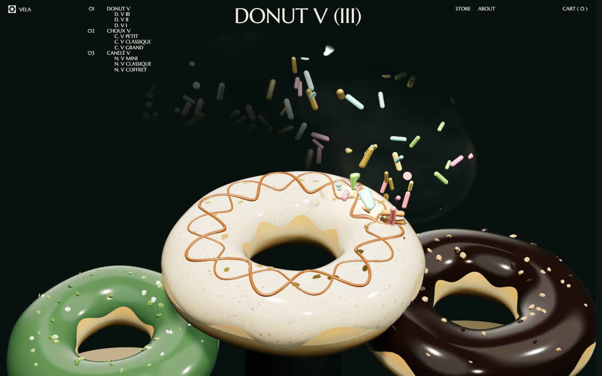
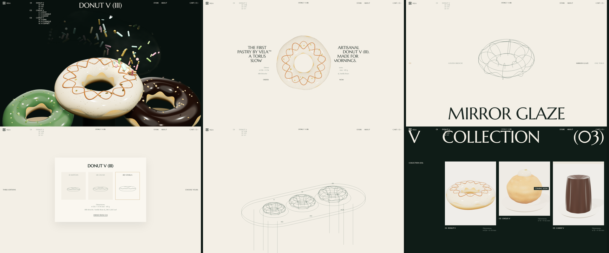
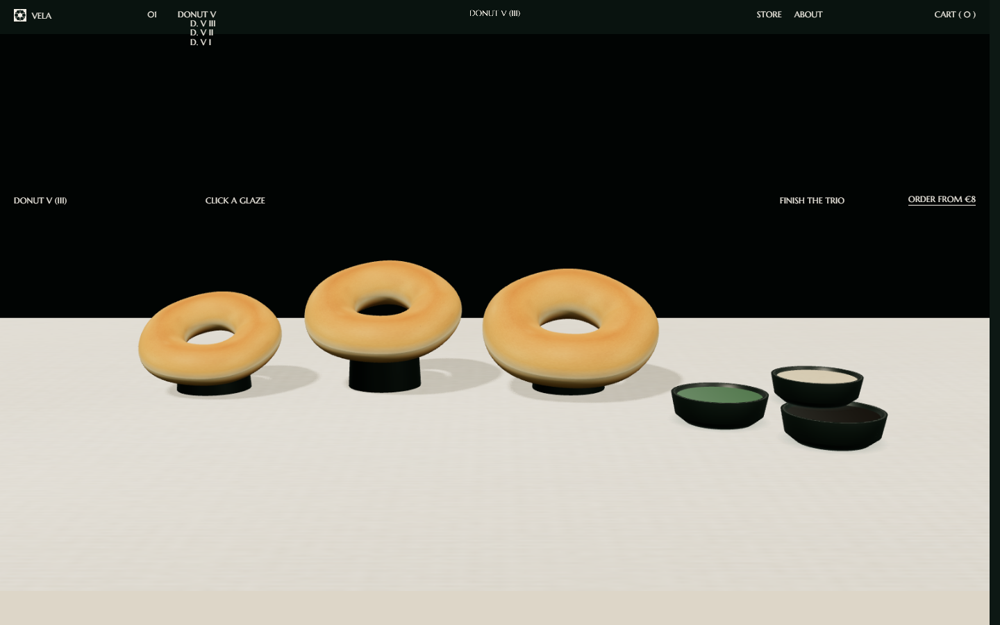
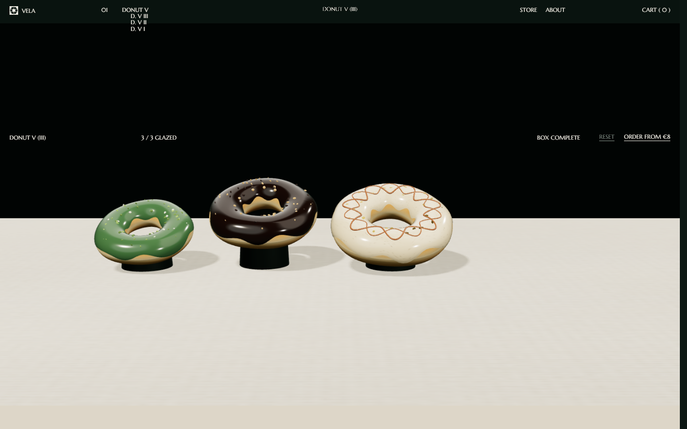
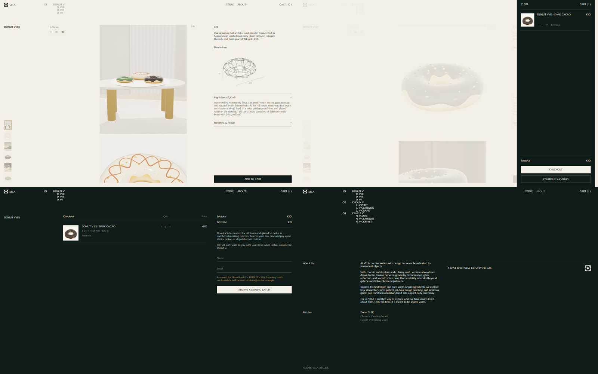
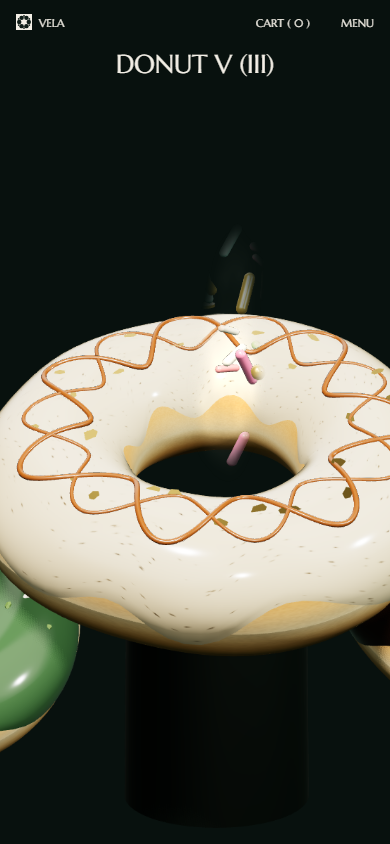
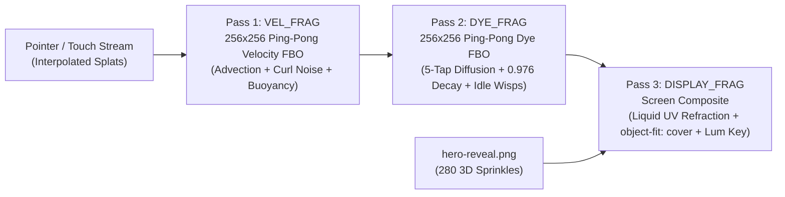

<div align="center">

# VELA — DONUT V (III)

### Architectural Luxury Patisserie Showcase & Interactive WebGL Studio

*A love for form, in every crumb. Zero frameworks. Pure WebGL1 GLSL, parametric 3D SVG drafting, 6-act scroll choreography, and a deterministic 25-plate Three.js PBR photography pipeline — shipped in ~27 KB gzipped.*

[](https://vela-atelier.pages.dev/)
[](https://vite.dev/)
[](./src/modules/hero-webgl.js)
[](./scripts/studio-renderer.html)
[](./src/main.js)
[](./scripts/verify-site.py)

<br />



*Move your cursor across the deep pine void to stir real-time swirling vapor that refracts and reveals 280 cascading glossy 3D donut sprinkles, sugar pearls, and 24K gold confetti.*

</div>

---

## Why This Project Exists

Most luxury product sites ship megabytes of bloated framework runtime and static stock photos. **VELA — DONUT V** explores the opposite extreme: **museum-grade editorial motion, custom GPU shaders, mathematical 3D CAD linework, and photorealistic 3D studio renders** built with vanilla ES modules, zero UI frameworks, and an automated Playwright visual verification suite.

> Want to fork this architecture for watches, fragrances, ceramics, sneakers, or coffee hardware? Read the full step-by-step engineering & re-skinning playbook in **[`BUILD_GUIDE.md`](./BUILD_GUIDE.md)**.

---

## Signature Highlights

| Feature | Engineering Under the Hood |
| --- | --- |
| **Interactive Fluid Sprinkle Reveal** | 3-pass `256×256` WebGL1 ping-pong velocity + dye FBO simulation with curl-noise vorticity, thermal upward buoyancy, liquid UV refraction, and GLSL `object-fit: cover` UV sync across desktop & mobile. Zero static background fog. |
| **12-Dot SDF Blooming Mark** | Custom WebGL1 fragment shader computing a smooth soft-boolean metaball union of 12 orbiting dots (`preloader` + `footer` replay) paired with a circular CSS `radial-gradient` iris wipe. |
| **6-Act Scroll Choreography** | Lenis-driven pinned viewport acts: monumental headline strip -> parting split copy & top-down photo-to-CAD `clip-path` wipe -> 3-beat 3D torus rotation -> 10-card 3D perspective spiral -> tilted edition card -> full-viewport isometric cafe table blueprint morph. |
| **Interactive "Glaze the Donut" Studio** | Split-horizon stage (`#09130f` pine / `#ddd6c8` limestone) using depth-only holdout occlusion (`colorWrite: false, depthWrite: true`) and 3D-projected clickable ceramic dipping bowls to glaze each brioche torus live. |
| **Parametric 3D SVG CAD Engine** | Real-time Euler projection (`cad-engine.js`) generating `1px` architectural sage drafting wireframes, undulating glaze drip contours, edition side elevations, and live millimeter callouts on the PDP. |
| **Headless 25-Plate PBR Studio** | Offline Three.js + Playwright Chromium studio (`studio-renderer.html` + `capture-studio.py`) that renders all 25 pixel-locked product, editorial, and transparent holdout plates locally with ACES Filmic tone mapping. |
| **Zero-Dependency SPA & E-Commerce** | History API routing (`/`, `/donut-v?size=I|II|III`, `/checkout`, `/about`), top Store drawer, 3-column fixed/scroll PDP, persistent `localStorage` Cart drawer, morning-batch waitlist checkout, and cursor-tracking `COMING SOON` pill. |

---

## Visual Tour

### 6-Act Editorial Choreography & Collection


### Interactive "Glaze the Donut" Split-Horizon Studio
Click the three ceramic dipping bowls (`UJI MATCHA (I)`, `DARK CACAO (II)`, `VANILLA GOLD (III)`) to coat each warm naked brioche ring with pixel-locked depth-occluded mirror glaze and toppings.

<table>
  <tr>
    <td width="50%" align="center">
      
      <br /><sub><b>Before:</b> Freshly proofed golden brioche rings + 3 ceramic glaze bowls</sub>
    </td>
    <td width="50%" align="center">
      
      <br /><sub><b>After:</b> <code>3 / 3 GLAZED</code> — holdout-occluded mirror glazes & toppings applied</sub>
    </td>
  </tr>
</table>

### Complete E-Commerce Overlays & Mobile Adaptation
<table>
  <tr>
    <td width="76%" align="center">
      
      <br /><sub>3-column <code>/donut-v</code> PDP with live CAD specs, Cart drawer, <code>/checkout</code> reservation, and <code>/about</code> manifesto</sub>
    </td>
    <td width="24%" align="center">
      
      <br /><sub><code>390×844</code> mobile layout — zero horizontal overflow</sub>
    </td>
  </tr>
</table>

---

## The Editions — `01 DONUT V`

| Edition | Flavor & Craft | Dimensions | Price |
| --- | --- | --- | --- |
| **DONUT V (I)** | 48h Brioche, Ceremonial Uji Matcha Mirror Glaze, Crushed Sicilian Pistachio & Sesame | `⌀ 82 × H 44 mm` · `95 g` | **€8** |
| **DONUT V (II)** | 48h Brioche, 72% Single-Origin Dark Cacao Ganache, Roasted Piedmont Hazelnut & Nibs | `⌀ 94 × H 48 mm` · `120 g` | **€10** |
| **DONUT V (III)** | 48h Brioche, Madagascar Vanilla Bean Ivory Glaze, Double Caramel Ribbon & 24K Gold Leaf | `⌀ 106 × H 54 mm` · `145 g` | **€14** |

*Companion silhouettes `02 CHOUX V` (golden craquelin cream puff) and `03 CANELÉ V` (12-fluted caramelized Bordeaux pastry) previewed as Coming Soon.*

### Deep Pine & Warm Alabaster Palette

| Role | Token | Hex |
| --- | --- | --- |
| Nocturnal Pine Ground | `--color-ground` / `--color-obsidian` | `#0d1814` / `#0f1c17` |
| Warm Travertine Alabaster | `--color-paper` / `--color-card` | `#f3efe6` / `#faf7f0` |
| Forest Charcoal Ink | `--color-ink-dark` | `#1a2621` |
| Architectural Sage CAD | `--color-line` | `#5c7065` |
| Burnished Brass Accent | `--color-accent` | `#b8925a` |

---

## GPU Fluid Reveal Pipeline



---

## Quick Start

### 1. Run the Site Locally
```bash
git clone https://github.com/risterz/vela-atelier.git
cd vela-atelier
npm install
npm run dev
```
Open **http://localhost:5178/** in your browser.

### 2. Build for Production
```bash
npm run build
npm run preview
```

### 3. Re-Render 3D Studio Photography Plates (Optional)
All 25 high-res PBR renders are pre-committed under `public/img/`. To modify geometry, lighting, glaze colors, or sprinkles in [`scripts/studio-renderer.html`](./scripts/studio-renderer.html) and re-capture:

```bash
pip install playwright
playwright install chromium

# Render all 25 plates
python -u scripts/capture-studio.py

# Or render specific shots only
python -u scripts/capture-studio.py hero-reveal studio-horizon
```

### 4. Run Automated E2E & Visual Verification
With `npm run dev` running on port `5178`:
```bash
python -u scripts/verify-site.py
```
Runs 13 automated assertions across desktop (`1440×900`) and mobile (`390×844`) — verifying brand integrity, fluid cursor reveal, all 6 scroll acts, interactive glaze studio, PDP edition switches, cart persistence, checkout submission, zero horizontal overflow, and zero console/page errors — outputting screenshots to `.verify_out/`.

---

## Project Structure

```text
vela-atelier/
├── index.html                  # SPA layout, 6-act story, split-horizon studio, 6 interactive overlays
├── BUILD_GUIDE.md              # Full technical architecture & 6-step re-skinning playbook
├── public/
│   ├── favicon.svg             # 12-dot brand emblem favicon
│   └── img/                    # 25 deterministic Three.js PBR studio & editorial plates
├── src/
│   ├── main.js                 # Lenis smooth scroll, choreography engine, studio state, cart & SPA router
│   ├── data/catalog.js         # Brand config, Donut V (I/II/III) editions, galleries & collection
│   ├── modules/
│   │   ├── hero-webgl.js       # 3-pass WebGL1 ping-pong fluid sprinkle reveal shader
│   │   ├── mark-webgl.js       # WebGL1 12-dot SDF metaball blooming mark + SVG generator
│   │   └── cad-engine.js       # Parametric 3D SVG wireframe & isometric table morph engine
│   └── styles/main.css         # 1440px -> --s fluid scale, theme tokens & responsive mobile layout
└── scripts/
    ├── studio-renderer.html    # Three.js WebGL2 procedural patisserie studio & 25 camera rigs
    ├── capture-studio.py       # Headless Playwright studio renderer + 3D hitbox projection
    └── verify-site.py          # 13-check Playwright desktop & mobile verification suite
```

---

## Documentation

- **[`BUILD_GUIDE.md`](./BUILD_GUIDE.md)** — Deep technical reference covering every GLSL shader pass, the `--s` proportional layout system, holdout occlusion masking, CAD math, performance guards, and a step-by-step checklist for adapting this template to any future product.

---

## License

Released under the [MIT License](./LICENSE).
